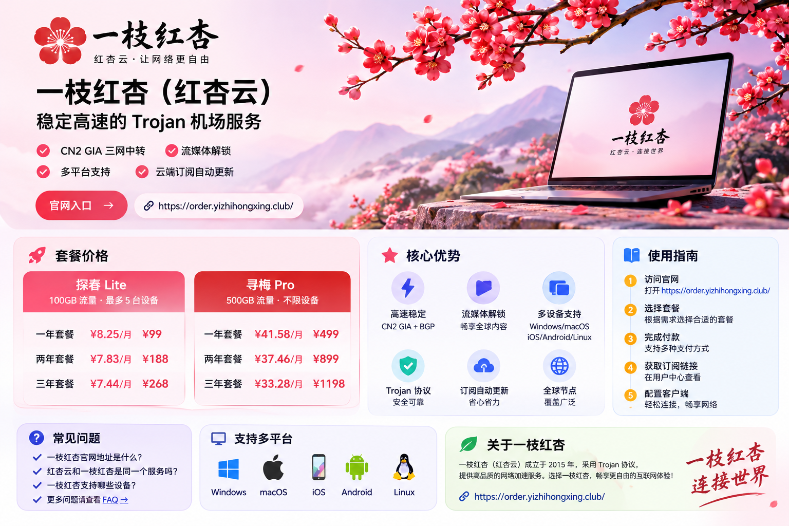
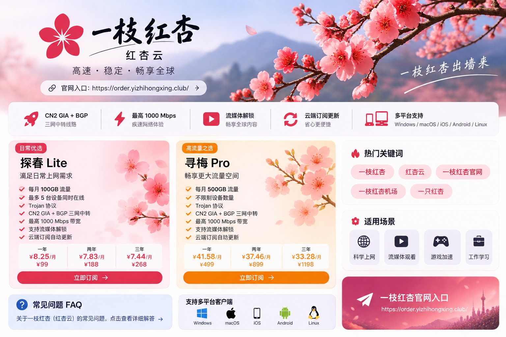

# 一枝红杏（红杏云）官网入口与使用指南

**一枝红杏 · 红杏云 · 一枝红杏官网 · 一枝红杏机场**

官网入口、套餐价格、服务信息、客户端支持与常见问题整理。

[官方网站](https://go2lk.pages.dev/cuakh4) · [最新域名](https://go2lk.pages.dev/cuakh4)

> 本项目是独立的信息整理与使用指南仓库，并非一枝红杏官方仓库。品牌、套餐及服务信息以官方网站实时公布内容为准。

## 目录

- [一枝红杏官网地址](#一枝红杏官网地址)
- [一枝红杏是什么](#一枝红杏是什么)
- [红杏云套餐价格](#红杏云套餐价格)
- [套餐如何选择](#套餐如何选择)
- [线路与服务特点](#线路与服务特点)
- [支持的平台与客户端](#支持的平台与客户端)
- [购买和使用步骤](#购买和使用步骤)
- [常见问题](#常见问题)
- [信息来源与更新说明](#信息来源与更新说明)

## 一枝红杏官网地址

| 项目 | 地址 |
| --- | --- |
| 一枝红杏官网 / 用户中心 | [https://order.yizhihongxing.club/](https://go2lk.pages.dev/cuakh4) |
| 官网页面公布的最新域名 | [https://order.yizhihongxing.org](https://go2lk.pages.dev/cuakh4) |
| 服务条款 | 请从官方网站页脚进入 |
| 联系方式 | 请通过官方网站的工单入口 |

如果你正在搜索“一枝红杏官网”“红杏云官网”或“一枝红杏机场”，建议先核对域名，再登录用户中心查看套餐和公告。域名可能调整，请以官网最新公告为准。

### 一枝红杏优惠码

- 优惠码：`11meigui`
- 优惠说明：全场9折，一年只有一次活动，请留意官网公告。
- 优惠有效期：长期有效

## 一枝红杏是什么？

一枝红杏（常被部分用户与“红杏云”这一搜索词关联）是提供 Trojan 订阅服务的网络服务品牌。官网页面标注其于 2015 年创立，并展示探春 Lite、寻梅 Pro 两类订阅。

官网公开页面介绍的服务信息包括：

- Trojan 订阅；
- CN2 GIA + BGP 三网中转线路；
- 页面标注最高 1000 Mbps；
- 流媒体解锁；
- 云端订阅自动更新；
- Windows、macOS、iOS、Android 和 Linux 平台支持。

以上属于服务页面的公开介绍，不代表对任何地区、运营商或时段的实际速度、可用性作出保证。实际体验可能受本地网络、设备、客户端和服务端状态影响。

## 红杏云套餐价格

以下价格根据官网页面当前可见信息整理。套餐、价格和促销可能调整，购买前请再次核对官方结账页面。

### 探春 Lite

| 订阅周期 | 每月折算 | 周期总价 | 月流量 | 同时在线设备 |
| --- | ---: | ---: | ---: | ---: |
| 1 年 | ¥8.25 | ¥99 | 100GB | 最多 5 台 |
| 2 年 | ¥7.83 | ¥188 | 100GB/月 | 最多 5 台 |
| 3 年 | ¥7.44 | ¥268 | 100GB/月 | 最多 5 台 |

### 寻梅 Pro

| 订阅周期 | 每月折算 | 周期总价 | 月流量 | 同时在线设备 |
| --- | ---: | ---: | ---: | ---: |
| 1 年 | ¥41.58 | ¥499 | 500GB | 不限设备数量 |
| 2 年 | ¥37.46 | ¥899 | 500GB/月 | 不限设备数量 |
| 3 年 | ¥33.28 | ¥1198 | 500GB/月 | 不限设备数量 |

## 套餐如何选择？

| 对比项目 | 探春 Lite | 寻梅 Pro |
| --- | --- | --- |
| 每月流量 | 100GB | 500GB |
| 同时在线设备 | 最多 5 台 | 不限设备数量 |
| 协议 | Trojan | Trojan |
| 更适合 | 日常流量需求 | 较高流量或多设备需求 |

选择套餐时，建议优先考虑每月实际流量、同时在线设备数量、订阅周期和退款规则，不要只看折算月价。长期套餐付款金额更高，购买前应充分了解服务条款和自身需求。

## 线路与服务特点

### CN2 GIA + BGP 三网中转

官网介绍采用 CN2 GIA + BGP 三网中转线路。线路名称本身不能完全代表实际体验，网络表现还会受到用户所在地区、接入运营商、国际出口和网络拥堵等因素影响。

### Trojan 订阅

官网套餐页面标注使用 Trojan 协议。请使用官方教程列出的兼容客户端，并妥善保管个人订阅链接。

### 流媒体解锁

官网介绍支持流媒体解锁。不同平台、地区、节点和时间的可用情况可能变化，建议以实际测试结果为准。

### 云端订阅自动更新

官网 FAQ 介绍支持云端订阅自动更新。客户端的订阅更新方式和更新频率，以客户端自身设置及官方教程为准。

## 支持的平台与客户端

官网 FAQ 列出的系统包括 Windows、macOS、iOS、Android 和 Linux；页面提及 Clash Verge、Shadowrocket、sing-box、Stash 等客户端。

| 平台 | 官网提及的客户端参考 |
| --- | --- |
| Windows | Clash Verge |
| macOS | Clash Verge |
| iOS | Shadowrocket、Stash |
| Android | 请参考官网兼容客户端说明 |
| Linux | sing-box |

客户端的安装渠道、系统版本要求和订阅格式可能变化，请以客户端官方发布渠道及一枝红杏官网教程为准。

## 购买和使用步骤

1. **访问官网：** 打开 [https://order.yizhihongxing.club/](https://go2lk.pages.dev/cuakh4) ，并核对官网公布的最新域名。
2. **查看套餐：** 对比探春 Lite 和寻梅 Pro 的流量、设备数、周期总价及服务条款。
3. **完成付款：** 按结账页面实际提供的方式操作。
4. **获取订阅：** 付款后登录用户中心，在“我的订阅”中查看订阅信息。
5. **配置客户端：** 按官方教程在兼容客户端中添加订阅，并按需更新配置。

订阅链接通常包含账户访问凭据，不要公开发布在 GitHub、论坛、截图或 Issue 中。

## 常见问题

### 一枝红杏官网地址是什么？

官网用户中心为 [https://order.yizhihongxing.club/](https://go2lk.pages.dev/cuakh4) 。官网页面同时公布了 [https://order.yizhihongxing.org](https://go2lk.pages.dev/cuakh4) 作为最新域名提示。访问前请留意官方公告和域名变化。

### 红杏云和一枝红杏是什么关系？

“一枝红杏”是官网使用的品牌名称。“红杏云”是用户搜索时可能使用的相关称呼。本仓库围绕这两个关键词整理公开资料，具体品牌关系以官方说明为准。

### 一枝红杏机场支持什么协议？

官网套餐页面标注使用 Trojan 协议。客户端是否兼容，请以客户端支持情况和官方教程为准。

### 探春 Lite 有多少流量？

官网页面当前展示探春 Lite 每月 100GB 流量，最多 5 台设备同时在线。

### 寻梅 Pro 有多少流量？

官网页面当前展示寻梅 Pro 每月 500GB 流量，不限设备数量。

### 流量会每月重置吗？

官网 FAQ 表示月流量按月重置。具体用量和重置时间可登录用户中心查看，或通过官网工单咨询。

### 购买后多久可以使用？

官网 FAQ 表示付款成功后即时开通，获取订阅链接后即可配置客户端。具体以订单状态为准。

### 一只红杏和一枝红杏有什么区别？

“一只红杏”可能是“一枝红杏”的输入或搜索变体。建议使用官网实际展示的品牌名称和域名，避免误入无关页面。

## 信息来源与更新说明

- 官方网站：[https://order.yizhihongxing.club/](https://go2lk.pages.dev/cuakh4)
- 官网公布的最新域名：[https://order.yizhihongxing.org](https://go2lk.pages.dev/cuakh4)
- 本仓库最后核对日期：2026-11-23
- 价格、套餐和服务信息可能变化，更新时以官网页面为准。

## 免责声明

本仓库为独立的信息整理项目，与一枝红杏服务提供方不存在官方隶属或授权关系。品牌名称、商标及相关内容归其权利人所有。仓库内容仅供信息参考，不构成服务质量、网络速度、持续运营或可用性的保证。购买前请自行阅读官方网站的服务条款、退款规则及相关说明。
